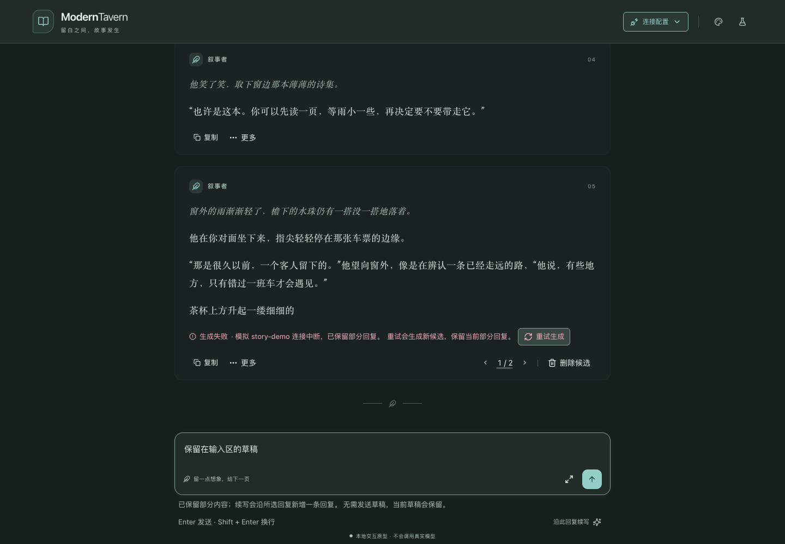

# 最新走查意见实施记录（2026-10-21）

依据 `ux-review-2026-10-20.md` 最新复查节，沿用当前分支及 shadcn-vue／Reka UI。保留用户已有 README、评审文档和截图改动，不将其混入实施提交。

## 改动与边界

| 批次 | 提交 | 实际改动 |
|---|---|---|
| A：R-01、R-02 | `097052b` | 恢复状态仅突出重试；继续改为沿此回复续写；根据所选候选正文区分空回复、部分回复和可切换版本 |
| B：R-03～R-05 | `4c2eba8` | 单候选禁用箭头；复用 markdownPreview；删除入口显示文字；最后候选明确删除候选及回复 |
| C：R-06～R-08 | `a68d186` | 减轻阅读卡片底色与边框，提高功能文字层级；真实危险确认与色板同步加删除图标；修复删除取消焦点返回 |

不改变生成、候选、草稿、命名和删除范围；没有新增框架。紅梅保留现有主题 token，以明确文案和图标区分危险操作。沿用既有动效和滚动机制。R-09 涉及术语与入口决策，本轮未实施。

## 本轮验证

日期为 Asia/Shanghai 2026-10-21；Google Chrome 155.0.8059.85，Playwright 隔离上下文；入口 `http://127.0.0.1:3100/`，复用已有开发服务。页面未暴露构建 SHA，因此浏览器结果基于工作树热更新，不声称运行构建与提交 SHA 严格绑定。

- 类型检查：通过，56 个 Vue／TypeScript 文件。
- 单元测试：41 通过、0 失败，包含候选生命周期、原文保护、Markdown 预览及十二色板的静态对比度检查。
- 生产构建：通过。与浏览器验证分别执行。
- 完整走查脚本：6/6 组通过，[结果](ux-followup-2026-10-21/browser-results.json)。矩阵覆盖六主题 × 亮暗 × 1440／390／360px × 阅读式／气泡式，共 72 种组合，逐项核对消息表面正文和辅助文字对比度 ≥ 4.5:1、页面无横向溢出。包含外观弹层、输入、通知、全屏停止、编辑和搜索流程。
- 恢复引导：验证部分失败／空失败、重试新增候选、切换后提示同步、草稿保留、单候选箭头禁用；没有实际模型请求。
- 首字前停止、刷新中断、最后候选删除确认取消与焦点返回：[结果](ux-followup-2026-10-21/stop-results.json)。取消前后持久化状态一致，没有确认真实删除。
- 危险确认补充矩阵：同样完整执行 72 种组合，实际打开候选删除菜单和确认框，检查删除图标、Escape 取消及焦点返回，通过；[结果](ux-followup-2026-10-21/matrix-results.json)。首轮补测的定位器在退出动画期间匹配了菜单和按钮两个同名元素，已在 `3616a99` 限定按钮角色并重跑完整矩阵通过。
- 滚动：平滑返回、主动中断、减少动态效果回归通过：[结果](ux-followup-2026-10-21/scroll-results.json)。

## 未验证边界

实现提交及测试修正已推送 `origin/codex/interaction-prototype`；本记录单独提交并推送。未运行远端 CI、未发布。真实手机软键盘、辅助技术、真实模型、后端保存、多设备一致性、长历史压力和动画性能不在本轮证明范围。色板静态对比度和浏览器实际消息表面对比度不能替代完整辅助技术审计或所有交互状态的像素测量。
