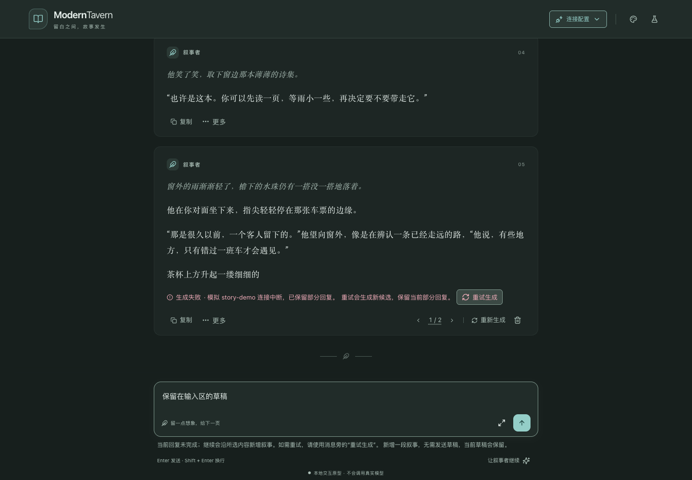
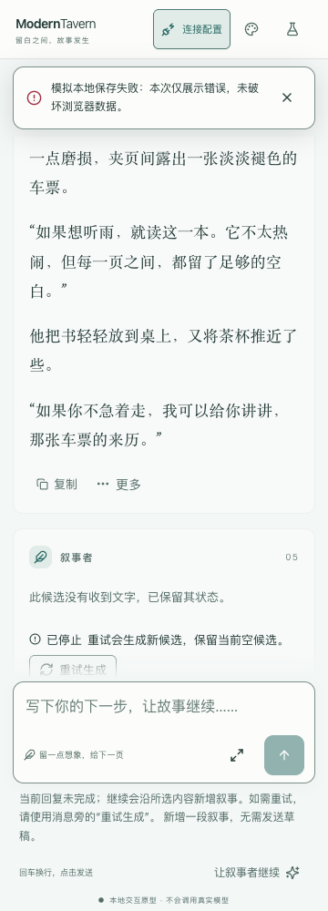
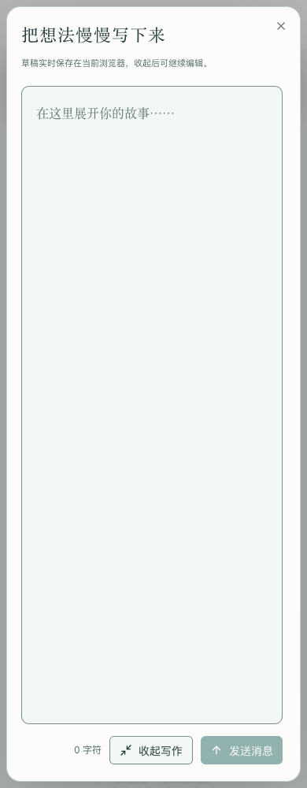
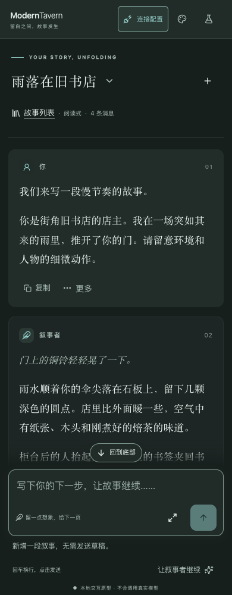

# 体验走查改进与验收记录

验证日期：2026-10-21（Asia/Shanghai）。分支：`codex/interaction-prototype`。

本轮按 `docs/ux-review-2026-10-20.md` 逐项改进本地交互原型，保留文学阅读风格、现有组件与业务契约。实施起点为 `1da2506`，最终应用代码为 `77a62e2`，专项验收脚本提交为 `eb7214f`。本记录不替代 PRD，不宣称生产能力完成。

## 逐项结果与提交

| 条目 | 结果 | 独立提交 |
|---|---|---|
| UX-01 | “让叙事者继续”使用独立图标与常显说明，明确新增叙事和草稿保留；末尾为用户消息仍显示“生成回复” | `e8f3492` |
| UX-02 | 编号菜单选择已有候选，显示状态、片段及当前标识；独立管理菜单保留删除任一候选与逐次确认 | `8a7bda7` |
| UX-03 | 通知显式携带成功、信息、警告、错误类型，并匹配图标与语义色；复制失败和模拟存储失败使用错误类型 | `bd3217a` |
| UX-04 | 通知进入顶部布局流；普通信息定时消失，错误与跳转通知保留；全屏写作生成中可停止 | `b636000` |
| UX-05 | 失败、刷新中断及停止后的末尾回复旁提供重试，说明新增候选、保留当前内容；继续操作提示未完成回复语义 | `51070c7` |
| UX-06 | 故事列表提供独立数据管理；外观面板仅恢复默认外观；数据清除继续完整确认 | `6a08731` |
| UX-07 | 标题下增加明确的故事列表图标与文字入口，保留品牌和标题入口、弹层关闭焦点返回 | `709c021` |
| UX-08 | **待产品决策**：保留默认时间戳名称及已有名称；搜索占位文案只澄清按名称搜索，不修改命名规则 | 未实施命名变更 |
| UX-09 | 示例填入后聚焦输入末尾，已有草稿不覆盖；进入编辑聚焦正文，退出返回菜单，Escape 使用取消确认 | `0bc88eb` |
| UX-10 | 复用 markdown-it token 生成列表纯文本片段，原文不变；处理空回复与未闭合标记，不渲染 HTML | `8d2b3d2` |
| UX-11 | 搜索空结果提供清空入口，新建清理查询；保留单个示例，明确填入草稿后手动发送 | `d7ad305` |
| UX-12 | 放大候选、错误和操作文字；复制及更多操作增加可见说明，保留语义色和窄屏触控尺寸 | `db343a6` |
| UX-13 | 亮暗分别使用黑色透明遮罩，减少背景模糊；保留既有模态与焦点机制 | `19ce8fc` |
| UX-14 | 减轻消息表面和边框，保留六主题、青磁默认、独立亮暗模式及身份标签与图标 | `879190f` |
| UX-15 | **既有能力回归通过**：保留原生平滑滚动、中断、自动跟随及减少动态效果，不新建动画机制 | `eb7214f` |

截图复核补充提交 `77a62e2`：通知降至模态层下，避免遮挡全屏写作说明；360px 收紧品牌区域，防止连接按钮挤压；将生成状态标签独立呈现。

本轮没有增加后端、认证、真实模型请求、导入导出、同步、断点续传或模板库，也没有修改候选生命周期、发送清空时点、上下文空候选规则、时间契约与数据删除范围。

## 自动化与浏览器结果

| 验证 | 本轮结果 | 证据 |
|---|---|---|
| 类型检查 | `bun run typecheck` 通过，56 个 Vue / TypeScript 文件 | 类型检查程序输出 |
| 单元测试 | `bun test`：39 通过，0 失败，281 次断言 | 新增通知类型及 Markdown 片段行为测试，保留原有领域与色板测试 |
| 生产构建 | `bun run build` 通过 | 最终应用代码 `77a62e2` 构建；本机预览健康响应由浏览器导航验证 |
| 完整基础浏览器回归 | 21/21 组通过 | [结果 JSON](ux-improvements-2026-10-21/browser-results.json) |
| 完整走查专项回归 | 5/5 组通过 | [结果 JSON](ux-improvements-2026-10-21/ux-results.json) |
| 稳定画面视觉矩阵复验 | 1/1 组通过，完整 72 组合 | [结果 JSON](ux-improvements-2026-10-21/visual-results.json) |
| 远端 CI、部署与真实模型 | 未运行 | 本轮为本地原型改进与本地提交 |

浏览器为独立 Google Chrome `155.0.8059.85` 上下文，不读取用户浏览器资料。预览仅监听本机。所有已保存的结果中，页面异常和外部请求列表均为空。

基础矩阵覆盖 1440×1000、390×1000，六主题 × 亮暗模式、系统模式切换；专项视觉矩阵另覆盖 360×1000，以及阅读式／气泡式，共六主题 × 两模式 × 三尺寸 × 两布局 = 72 组合。实际消息表面由浏览器计算 `color-mix` 后采样，正文及辅助文字对比度均至少 4.5:1；边界、焦点、按钮及功能色 token 的目标由十二套色板单元测试验证。此结果不是完整无障碍审计。

专项还覆盖选择候选不触发生成、生成中禁用、部分失败转空失败后的重试与旧候选保留、非空草稿保护、全屏停止、通知位置、示例和编辑焦点、取消编辑确认、空搜索清空、外观重置不触及业务数据。通过注入浏览器存储配额错误，独立验证真实顶部保存失败提示；剪贴板拒绝权限验证与其分开，模拟保存失败不会冒充真实存储故障。

动效回归包含观察多个动画帧验证平滑滚动、滚轮中断、停止后位置稳定、回到底部后恢复跟随、减少动态效果直接定位，以及上滑期间输出不拉回。弹层退出后再采集稳定画面；未测量动画帧率或长历史性能。

首轮基础验收为 18/21；状态标签变化及旧菜单／通知定位修正后，最终代码重跑完整基础矩阵为 21/21。专项截图曾截到弹窗退出过程，因此增加关闭等待，再完整重跑 72 组合并重新取证，未用局部重跑代替最终视觉矩阵。

## 视觉证据

改前参见工作区原始走查材料中的存储通知与部分失败截图；原始走查文档和截图未混入本轮代码提交。以下为最终代码的本轮截图，均为本地演示内容。

### 失败后的恢复操作

### 360px 通知与输入操作

### 全屏写作叠层

### 暗色阅读

## 验收边界与剩余事项

- UX-08 的默认命名变化仍需明确产品决策并同步 PRD；不阻塞其他条目。
- 真实手机软键盘、辅助技术、真实模型连接、后端保存恢复、多设备一致性、长历史压力与动画性能未验证。
- Chrome 自动化验证了运行中的浏览器行为及布局，截图经过复核；不替代真实手机和人工辅助技术验收。
- 所有实现均为本地原型；Git 提交不代表已推送、CI 通过或正式发布。
